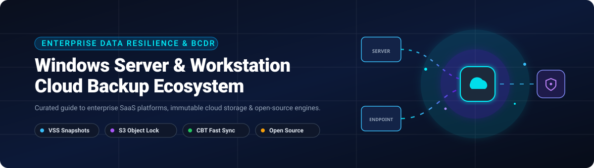

# Awesome Windows Server & Workstation Cloud Backup

  

  
  
  
  
  
  

> 🚀 A curated, production-tested directory of top Windows Server and Workstation Cloud Backup platforms — featuring enterprise SaaS/Hosted commercial solutions with verified pricing and valuations, alongside high-performance open-source alternatives for protecting physical and virtual Windows infrastructure to the cloud.  
> 🌟 **Star this repo if you find it useful!** 🌟

---

## 📑 Table of Contents

- [📈 Sector Overview & Market Dynamics](#-sector-overview--market-dynamics)
- [🟦 SaaS / Commercial Hosted Platforms](#-saas--commercial-hosted-platforms)
  - [🔍 SaaS Platforms Feature Comparison](#-saas-platforms-feature-comparison)
- [🟩 Open-Source Software](#-open-source-software)
  - [🛠️ Open-Source Solutions Comparison](#️-open-source-solutions-comparison)
- [🏗️ Key Architectural Concepts for Windows Backup](#️-key-architectural-concepts-for-windows-backup)
- [💖 Support & Sponsorship](#-support--sponsorship)
- [⭐ Star History](#-star-history)
- [🤝 Contributing](#-contributing)
- [📄 License](#-license)

---

## 📈 Sector Overview & Market Dynamics

The enterprise backup and recovery software market is valued at approximately **$13 billion to $16 billion**, with projections indicating rapid expansion toward **$30 billion to $50 billion** by 2035 (advancing at a compound annual growth rate of ~10–11% 📊). Driven by aggressive enterprise cloud migrations, stringent data compliance mandates (GDPR, HIPAA, NIS2 🔒), and the exponential rise of sophisticated ransomware targeting backup catalogs, data protection has evolved from passive archival into active cyber-resilience and rapid recovery engineering 🛡️.

From a market structure perspective, the sector exhibits **moderate-to-high fragmentation at the ecosystem level while undergoing aggressive consolidation at the enterprise tier** 🧩. Tool sprawl remains prevalent across mid-market and heterogeneous enterprises—where organizations frequently juggle distinct solutions for endpoints, virtualization, and SaaS applications—yet enterprise procurement is heavily standardizing toward single-pane-of-glass cyber-resilience platforms 🌐. Industry powerhouses such as Veeam, Rubrik, Cohesity (absorbing Veritas' enterprise data protection unit), and Commvault dominate enterprise wallet share through strategic acquisitions, multi-cloud unified fabrics, and native AI-powered anomaly detection 🤖.

---

## 🟦 SaaS / Commercial Hosted Platforms

The table below catalogs leading commercial and hosted Windows Server and Workstation cloud backup solutions. The table is ranked in **descending order by company scale** (company valuation or market capitalization 💼).

| 🏢 Platform | 💰 Company Valuation / Revenue | 🏷️ Starting Pricing Tier | ⏱️ Free Tier / Trial Limit | ⚙️ Key Windows Capabilities | ☁️ Deployment Model |
|:---|:---|:---|:---|:---|:---|
| **[Rubrik](https://www.rubrik.com)** 🛡️ | **~$24B – $25B** valuation (Market Cap; ~$1.54B TTM Rev) | ~$130 – $230/TB/month (Rubrik Security Cloud software subscription baseline; min contract ~$50k/yr) | 30-day guided POC trial (or targeted SaaS trial on request; sales-assisted evaluation) | Policy-governed fileset templates, immutable append-only snapshots, bare-metal restore, native VSS integration | Cloud-Native / Hybrid SaaS Appliance |
| **[Veeam Software](https://www.veeam.com)** ⚡ | **$15B** valuation (~$2.0B ARR leader) | $1,020/year for 10-instance Veeam Data Platform Essentials bundle (~$8.50/workload/month) | **Free forever: 10 workloads** (Veeam Community Edition); 30-day unlimited trial falls back to Community | Changed Block Tracking (CBT), bare-metal recovery, granular file/volume/application items, Cloud Connect | Agent-managed / Hybrid Cloud |
| **[Cohesity](https://www.cohesity.com)** 🔗 | **$7B** valuation (incl. Veritas EDP; ~$1.7B pro-forma Rev) | ~$120 – $200/BETB/month (Backend Terabyte capacity subscription baseline via Cohesity BaaS) | 30-day free trial (Cohesity Data Cloud / BaaS platform access) | CBT filter driver for Windows, VSS application consistency, VHD/VHDx instant mount, Cohesity FortKnox vaulting | Hyperconverged Appliance / SaaS |
| **[Commvault](https://www.commvault.com)** 🗄️ | **~$6.5B – $7B** valuation (Market Cap; ~$1.1B ARR) | $58.50/TB/month (Commvault Cloud SaaS File & Object); self-managed from $150/FETB/year or $98/VM/year | 30-day free trial (Full Commvault Cloud SaaS platform access with cloud storage) | Windows File System iDataAgent, block-level backup, MSCS clustering, client-side deduplication, synthetic fulls | Cloud-Native SaaS / Self-Managed Hybrid |
| **[Datto](https://www.datto.com)** 📡 | **$6.2B** acquisition valuation by Kaseya ($1.5B+ ARR) | ~$65 – $95/server/month (Billed via MSP partner agreements, bundling SIRIS cloud retention) | 30-day free trial (Full partner/MSP evaluation appliance and agent sandbox) | Datto Windows Agent (DWA) 3.0+, HashCache I/O reduction, live virtualization, VSS conflict arbitration | Hybrid BCDR Appliance + Cloud |
| **[Quest Software](https://www.quest.com)** ⏱️ | **$5.4B** valuation (~$500M – $1B Rev) | ~$1,100 – $1,800/server perpetual license + annual maintenance (~$95/workload/month subscription) | 14-day free trial (Rapid Recovery core software download with full feature set) | 5-minute RPO snapshot intervals, Live Recovery instant restore, Changed Block Tracking, S3 Object Lock | On-Premises Core + Multi-Cloud Archive |
| **[Acronis](https://www.acronis.com)** 🔒 | **$3.5B** valuation (~$400M – $500M Rev) | $85/workload/year for Cyber Protect Standard (~$7.08/workload/month); Cloud MSP at ~$3.00/workload + $0.03/GB | 30-day free trial (Full-featured trial of Acronis Cyber Protect with 1 TB cloud storage) | Unified backup + active anti-ransomware, VSS disk/partition image, Exchange/SQL/AD application awareness | Cloud-Native SaaS / Agent-based Hybrid |
| **[Druva](https://www.druva.com)** ☁️ | **$2B** valuation (~$200M+ SaaS ARR) | $210 – $300/TB/month (Enterprise Workloads credit consumption based on post-dedup cloud storage) | 30-day free trial (Full SaaS access for enterprise workloads without credit card) | 100% SaaS-native agent, VSS recovery points, global client-side deduplication, direct-to-cloud AWS architecture | 100% Serverless SaaS |
| **[Carbonite](https://www.carbonite.com)** 📦 | **$1.45B** acquisition valuation by OpenText | $50.00/month billed annually at $799.99/year (Safe Server Power Plan: 1 server + 25 PCs, 500 GB cloud) | 30-day free trial (Carbonite Safe Pro / Server business trial with up to 250 GB storage) | Incremental-forever protection, VSS open-file support, granular restore for Exchange, SQL, Active Directory | Hybrid Cloud Agent |
| **[Arcserve](https://www.arcserve.com)** 💽 | **~$700M** enterprise valuation (~$120M – $150M Rev) | ~$60 – $85/TB/month capacity subscription; Perpetual socket from ~$695 + maintenance | **Free forever: UDP Workstation Free Edition** (endpoints); 30-day free trial for UDP Server & Cloud Hybrid | Hardware VSS snapshot offload to SAN/NAS, block-level deduplication, standby virtual machine replication | Hybrid Software / Appliance / Cloud |
| **[NAKIVO](https://www.nakivo.com)** 🚀 | **~$150M** valuation (~$25M – $35M Rev) | $2.45/workload/month billed annually ($29.40/workload/year Pro Essentials tier) | **Free forever: 10 workloads** (or 30 physical workstations) for 1 year renewable; 15-day full trial | Full physical Windows Server & desktop image, S3/Wasabi/Azure Blob immutable backups, P2V instant boot | Self-Hosted Software / Virtual Appliance |

### 🔍 SaaS Platforms Feature Comparison

- **Druva Windows Backup** ☁️: Completely serverless backup that eliminates local storage hardware. Leverages Microsoft VSS to stream application-consistent incremental-forever snapshots directly into AWS cold/warm tiers.
- **Veeam Agent for Microsoft Windows** ⚡: Industry-standard agent supporting standalone or centrally managed operation. Offers granular item-level restore for Microsoft SQL, Exchange, and Active Directory, plus automated disaster recovery staging via Veeam Cloud Connect.
- **Commvault Windows File System Agent** 🗄️: Enterprise-grade agent optimized for complex topologies including clustered shared volumes (CSV), Scale-Out File Server (SOFS), and massive unstructured file pools with client-side deduplication.
- **Cohesity Windows Agent** 🔗: High-throughput file and block protection using custom changed block tracking drivers. Backups are stored natively as VHD/VHDx formats for instantaneous physical-to-virtual (P2V) disaster recovery testing.
- **Rubrik Windows Protection** 🛡️: Declarative SLA-driven fileset policy engine. Implements immutable append-only storage architectures that protect Windows backups against unauthorized modification or deletion during ransomware events.
- **Acronis Cyber Protect Windows Server** 🔒: Combines disk-image and file-level cloud backup with integrated behavioral ransomware detection, vulnerability assessment, and automated patch management in a unified Windows agent.
- **Datto Windows Agent** 📡: Tailored for MSPs and continuous business continuity, combining driver-level VSS synchronization with proprietary HashCache acceleration to eliminate local disk I/O bottlenecks.
- **Carbonite Server Backup** 📦: Hybrid local-and-cloud architecture designed for small-to-midsize businesses requiring simple push-button cloud failover and comprehensive legacy Windows Server OS support (2008 R2 through 2025).
- **Quest Rapid Recovery** ⏱️: Engineered for tight recovery point objectives with snapshot frequencies as granular as every five minutes, coupled with Live Recovery capabilities that enable instant workload productivity during background restore.
- **Arcserve UDP Windows** 💽: Enterprise resilience supporting SAN/NAS hardware VSS snapshot integration to completely offload snapshot processing and I/O overhead from production host servers.
- **NAKIVO Windows Backup** 🚀: Lightweight, budget-friendly enterprise backup featuring native air-gapped immutable storage integration (AWS S3 Object Lock, Wasabi, Azure Blob, and local Linux repositories).

---

## 🟩 Open-Source Software

Self-hosted, transparent, and community-driven tools for backing up Windows Server and Workstation environments to local storage, NAS/SAN, or cloud object storage. All listed projects are sorted in **descending order by GitHub Stars_Count** ⭐.

| 🧰 Tool | ⭐ GitHub_Stars | 💻 Primary Language / Stack | 📜 License | 📸 Windows Snapshot (VSS) | 🌐 Primary Cloud Targets |
|:---|:---|:---|:---|:---|:---|
| **[Rclone](https://github.com/rclone/rclone)** |  | Go | MIT | External script wrapper | S3, Azure Blob, Google Cloud Storage, B2, OneDrive, SFTP (70+ backends) |
| **[Restic](https://github.com/restic/restic)** |  | Go | BSD-2-Clause | ❌ (File-level / VSS via script) | AWS S3, Azure Blob, Wasabi, Backblaze B2, Google Cloud Storage, SFTP, REST |
| **[Duplicati](https://github.com/duplicati/duplicati)** |  | C# / .NET | MIT / LGPL-2.1 | ✅ (Native VSS open file support) | Amazon S3, Microsoft Azure, Google Drive, Backblaze B2, Mega, WebDAV |
| **[BorgBackup](https://github.com/borgbackup/borg)** |  | Python / C / Cython | BSD-3-Clause | ❌ (Native on WSL2 / Cygwin) | BorgBase, SSH / SFTP storage repositories, Cloud object storage via Borgmatic |
| **[Kopia](https://github.com/kopia/kopia)** |  | Go | Apache-2.0 | ✅ (VSS support on Windows) | Amazon S3, Azure Blob, Google Cloud Storage, Backblaze B2, WebDAV, SFTP |
| **[Backrest](https://github.com/garethgeorge/backrest)** |  | Go / React | GPL-3.0 | ❌ (Leverages Restic engine) | Any Restic-supported backend (S3, B2, Azure, MinIO, SFTP, Local) |
| **[Rustic](https://github.com/rustic-rs/rustic)** |  | Rust | Apache-2.0 / MIT | ❌ (File-level) | AWS S3, Azure Blob, REST, SFTP, Local storage, Restic-compatible repositories |
| **[Bareos](https://github.com/bareos/bareos)** |  | C / C++ / Python | AGPL-3.0 | ✅ (Native Windows VSS plugin) | S3 Object Storage, Ceph, GlusterFS, Local Disks, Enterprise Tape (LTO) |
| **[UrBackup](https://github.com/uroni/urbackup_backend)** |  | C++ | AGPL-3.0 | ✅ (Full image VHD/VHDx + file VSS) | Self-hosted storage server, S3-compatible cloud storage, NAS / SAN |

### 🛠️ Open-Source Solutions Comparison

#### 1. Rclone 🚀
- **GitHub**: [rclone/rclone](https://github.com/rclone/rclone)
- **Stack**: Go | **License**: MIT
- **Best For**: Multi-cloud file synchronization, bandwidth-throttled offsite replication, and scriptable data movement across 70+ cloud storage services.
- **Windows Integration**: Supports Windows CLI, PowerShell orchestration, and Windows Services (via NSSM or native task scheduler). Frequently paired with Restic, Borg, or scripts to push local VSS snapshots to Wasabi, Backblaze B2, or Amazon S3.

#### 2. Restic 🔐
- **GitHub**: [restic/restic](https://github.com/restic/restic)
- **Stack**: Go | **License**: BSD 2-Clause
- **Best For**: High-security, tamper-resistant CLI backups with client-side zero-knowledge encryption and global chunk-level deduplication.
- **Windows Integration**: Compiles to a single zero-dependency static Windows `.exe`. Uses cryptography (AES-256 and Poly1305-AES) to treat all cloud repositories as untrusted.

#### 3. Duplicati 🗂️
- **GitHub**: [duplicati/duplicati](https://github.com/duplicati/duplicati)
- **Stack**: C# / .NET | **License**: MIT / LGPL
- **Best For**: Desktop and server administrators wanting a graphical web UI, native Volume Shadow Copy Service (VSS) support for backing up locked files, and strong client-side encryption.
- **Windows Integration**: Built directly for the Windows ecosystem with native support for Microsoft VSS writers to snapshot locked Outlook PSTs, open databases, and system configuration files.

#### 4. BorgBackup 📦
- **GitHub**: [borgbackup/borg](https://github.com/borgbackup/borg)
- **Stack**: Python / C | **License**: BSD 3-Clause
- **Best For**: Deduplicating enterprise archival where authenticated encryption and high-ratio LZ4/Zstandard compression are prioritized.
- **Windows Integration**: Runs smoothly on Windows Server using WSL2 or Cygwin environments; widely used across mixed Linux/Windows fleets managed through configuration tools like Borgmatic.

#### 5. Kopia ⚡
- **GitHub**: [kopia/kopia](https://github.com/kopia/kopia)
- **Stack**: Go | **License**: Apache 2.0
- **Best For**: Fast, modern, snapshot-driven cloud backup with both an intuitive desktop GUI and scriptable CLI.
- **Windows Integration**: Fully integrates with Windows Volume Shadow Copy (VSS) to capture coherent disk snapshots, with out-of-the-box support for direct-to-cloud connections (AWS S3, Google Cloud, Azure, Backblaze B2).

#### 6. Backrest 🖥️
- **GitHub**: [garethgeorge/backrest](https://github.com/garethgeorge/backrest)
- **Stack**: Go / React | **License**: GPL-3.0
- **Best For**: Providing an intuitive, modern web-based orchestration dashboard and monitoring system on top of Restic.
- **Windows Integration**: Runs as a lightweight local Windows service or scheduled task, exposing snapshot browsing, retention pruning policies, automated scheduling, and Discord/Slack alert webhooks.

#### 7. Rustic 🦀
- **GitHub**: [rustic-rs/rustic](https://github.com/rustic-rs/rustic)
- **Stack**: Rust | **License**: Apache 2.0 / MIT
- **Best For**: Ultra-fast, memory-safe backup execution leveraging modern Rust multi-threading and repository compatibility with the Restic format.
- **Windows Integration**: Distributed as a single self-contained Windows executable requiring zero external dependencies or runtimes.

#### 8. Bareos (Backup Archiving Recovery Open Sourced) 🏢
- **GitHub**: [bareos/bareos](https://github.com/bareos/bareos)
- **Stack**: C / C++ / Python | **License**: AGPL-3.0
- **Best For**: Large-scale heterogeneous enterprise environments needing a robust open-source alternative to legacy commercial backup suites.
- **Windows Integration**: Features a dedicated Windows Client Agent with deep Microsoft VSS plugins for application-consistent backups of Windows Server file systems, Active Directory, and Microsoft SQL Server.

#### 9. UrBackup 💾
- **GitHub**: [uroni/urbackup_backend](https://github.com/uroni/urbackup_backend)
- **Stack**: C++ | **License**: AGPL-3.0
- **Best For**: Centralized network client-server architectures requiring live bare-metal image-level backups (VHD/VHDx) alongside granular file-level restore.
- **Windows Integration**: Installs a lightweight Windows background client that performs real-time image creation while the OS is operating, allowing fast bare-metal restore via bootable media.

---

## 🏗️ Key Architectural Concepts for Windows Backup

When architecting a cloud backup strategy for Windows Server or Workstation environments, ensure your chosen solution accounts for the following core pillars:

1. **Volume Shadow Copy Service (VSS) Application Consistency** 📸:  
   Backing up live Windows systems without VSS causes snapshot crashes or inconsistent database tables (especially in SQL Server, Exchange, or Hyper-V). Enterprise tools invoke VSS requestors, writers, and providers to guarantee point-in-time database integrity before data transfer.

2. **Changed Block Tracking (CBT)** ⏩:  
   Rather than scanning millions of file directory trees daily, kernel-level CBT drivers monitor modified clusters at the file system or block layer, reducing daily backup windows from hours to seconds.

3. **Immutability & Object Lock** 🛡️:  
   Modern ransomware strains actively seek out backup catalogs and volume shadow copies (`vssadmin delete shadows`). Cloud-native object lock (WORM — Write Once, Read Many) in AWS S3, Wasabi, or Azure Blob ensures that neither compromised administrator credentials nor malicious malware payloads can alter or delete recovery points within the retention window.

4. **Bare-Metal Recovery (BMR) vs. Granular File Restore** 🔄:  
   Image-level backups (VHD/VHDx or raw images) enable full system rebuilds after hardware catastrophes, whereas file-level deduplicated backups preserve network bandwidth and enable instant restoration of individual accidental deletions.

---

## 💖 Support & Sponsorship

Thank you so much for using and exploring this curated data protection guide! 💙

If this project saved you hours of research, helped you evaluate your enterprise backup infrastructure, or provided useful insights into Windows data resilience:

- ⭐ **Star** this repository on GitHub to help others discover it.
- 🍴 **Fork** it and contribute new tools, updates, or benchmark findings.
- 📢 **Share** it with fellow system administrators, DevOps engineers, and IT architects.
- ☕ **Buy a coffee / Sponsor**: If you'd like to support ongoing curation and open-source contributions, please check out the [GitHub Sponsor Dashboard](https://github.com/sponsors/ishandutta2007).

---

## ⭐ Star History

---

## 🤝 Contributing

Contributions are warmly welcomed! If you know of an active open-source Windows backup tool or a significant change in commercial platform capabilities:

1. 🍴 Fork the repository.
2. ✍️ Add the tool to the appropriate section maintaining alphabetical or sorted conventions.
3. 🔗 Include project URL, GitHub Stars_Badge, license, and Windows integration details.
4. 🚀 Submit a Pull Request with a concise summary of the addition.

---

## 📄 License

This repository and curated list are released under the [CC0 1.0 Universal (Public Domain)](https://creativecommons.org/publicdomain/zero/1.0/) license. Individual referenced projects and software packages maintain their respective software licenses.

---

⭐ **If this curated resource helps your Windows disaster recovery planning, please star the repository!** ⭐
